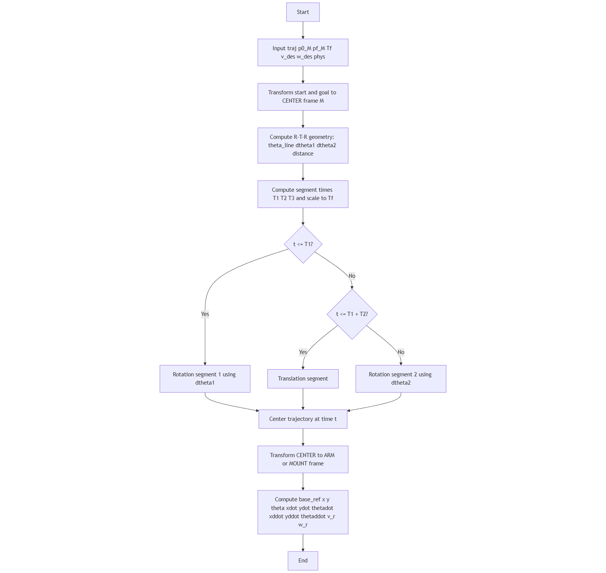
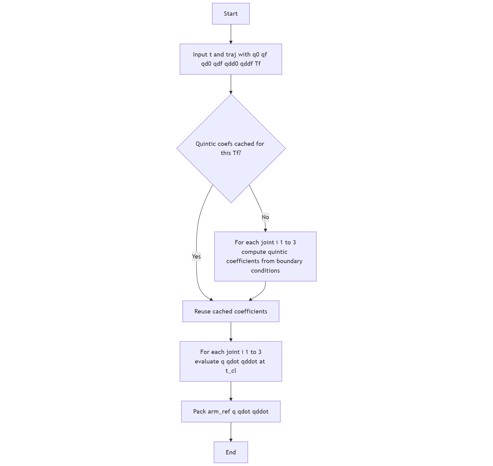
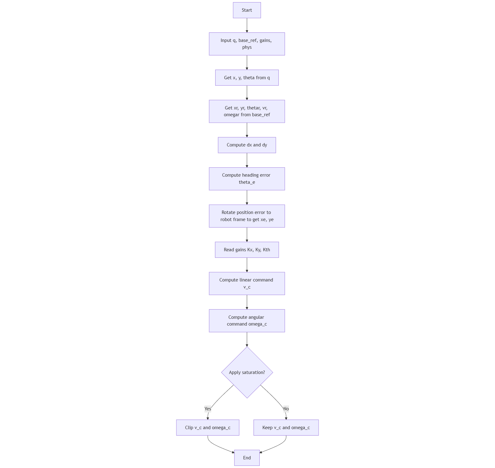
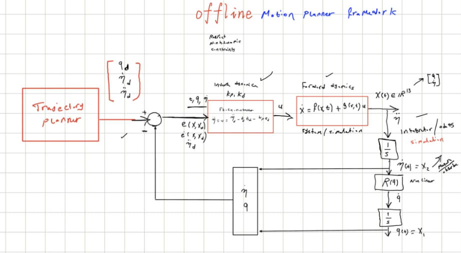
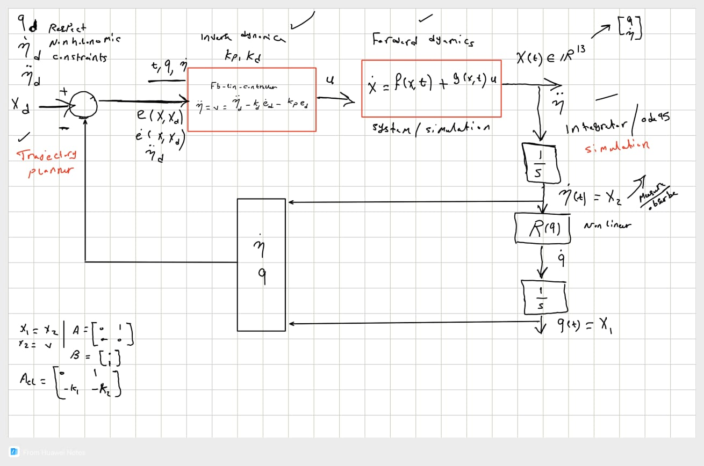
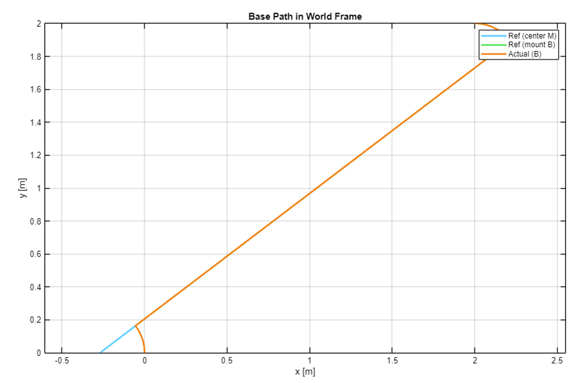
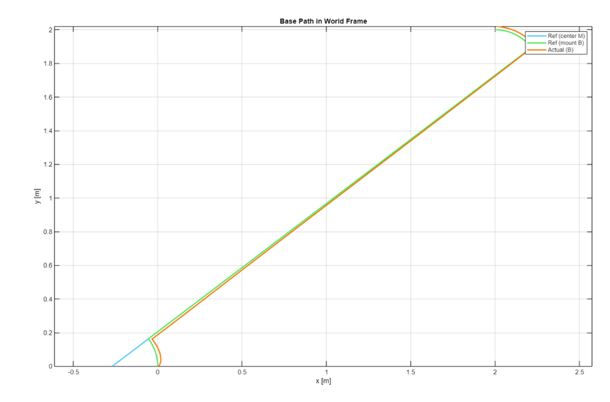
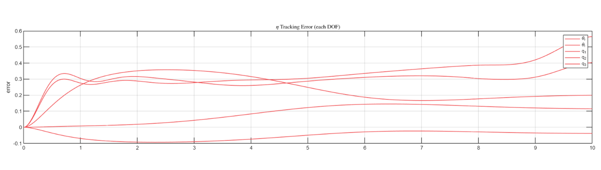

# Wheeled Mobile Manipulator Planning and Tracking

MATLAB framework for generating and tracking whole-body trajectories for a differential-drive mobile manipulator with a 3-DOF arm.

This repository contains the public project code, report artifacts, presentation visuals, and simulation figures for a layered planning-and-control stack. The work is not only trajectory tracking: it also generates smooth base and arm references, coordinates them kinematically, and tracks the resulting reduced-coordinate trajectory at the torque level.

## Overview

The project studies a differential-drive mobile manipulator with two actuated wheels and a 3-DOF serial arm.

The implemented stack follows three layers:

| Layer | Role | Main idea |
|---|---|---|
| Layer 3 | Motion planning | Generate smooth base and arm references. |
| Layer 2 | Kinematic coordination | Convert planned motion into admissible base/arm velocity commands. |
| Layer 1 | Dynamic tracking | Use reduced-coordinate feedback linearization to track the generated references at the torque level. |

The report evaluates planner-only behavior, disturbance cases, and the full three-layer stack using tracking error, torque, power, and accumulated energy plots.

## Research / Engineering Motivation

Mobile manipulation requires more than a geometric path. The base and arm must move together while respecting:

- nonholonomic differential-drive constraints,
- base-arm coupling,
- smooth reference generation,
- kinematic tracking,
- torque-level dynamics,
- robustness under disturbances,
- effort and energy metrics.

This repository supports my broader robotics/control research identity by showing a concrete planning-and-tracking workflow for mobile manipulation.

## What Is Implemented

- Constraint-consistent reduced-coordinate modeling using independent coordinates `eta`.
- Base trajectory generation in `SE(2)` using rotate-translate-rotate motion with quintic timing.
- Arm joint-space trajectory generation using quintic polynomials.
- Reference builder for `eta`, `eta_dot`, and `eta_ddot`.
- Kanayama-style base kinematic tracking.
- Arm velocity PD coordination.
- Torque-level feedback-linearization tracking.
- Disturbance injection at the torque level.
- Post-processing for wheel/arm torques, power, energy, and tracking error.
- MATLAB live scripts, functions, tests, report figures, and presentation visuals.

## Mathematical Core

The implementation uses independent reduced coordinates for the two wheel angles and three arm joints:

$$
\eta =
\begin{bmatrix}
\theta_r & \theta_l & q_1 & q_2 & q_3
\end{bmatrix}^{T},
\qquad
\dot{q}=R(q)\dot{\eta}.
$$

The reduced dynamics tracked by the low-level controller are:

$$
M_1(q)\ddot{\eta}
+\left(C_1(q,\dot{q})+D_{\eta}\right)\dot{\eta}
+G_1(q)
=B_1(q)\tau.
$$

The feedback-linearization layer shapes the reduced-coordinate tracking error with:

$$
e=\eta-\eta_d,
\qquad
\dot{e}=\dot{\eta}-\dot{\eta}_d,
$$

$$
v=\ddot{\eta}_d-K_d\dot{e}-K_p e,
$$

then computes the actuator torques:

$$
\tau =
B_1(q)^{-1}
\left[
M_1(q)v
+\left(C_1(q,\dot{q})+D_{\eta}\right)\dot{\eta}
+G_1(q)
\right].
$$

The planner uses quintic time scaling for smooth segment transitions:

$$
\sigma(s)=10s^3-15s^4+6s^5,
\qquad
s\in[0,1].
$$

Full derivations and experiment details are provided in the project paper.

## Demo Gallery

The images below are real public artifacts from the project presentations and report.

### Planning and Coordination Flowcharts

| Base planner | Arm planner | Kinematic tracking |
|---|---|---|
|  |  |  |

### Conceptual Block Diagrams

| Offline motion-planner framework | Feedback-linearization tracking structure |
|---|---|
|  |  |

### Simulation Outputs

| Planner-only base path | Full stack under disturbance | Tracking error under disturbance |
|---|---|---|
|  |  |  |

## Repository Structure

```text
wheeled_manipulator_framework/
  control/        planner, kinematic controller, feedback-linearization tracker, tests
  models/         symbolic/numeric dynamics, reduced model utilities, generated functions
  figures/        paper/result figures
  docs/           report PDF, slides, references, auxiliary documents
  tests/          MATLAB checks for model/constraint components

report/           paper source, compiled PDF, and paper figures
presentations/    progress slides and exported flowchart images
mobile_robot/     earlier mobile-robot planning/control exercises
media/demo/       README demo images copied from real project artifacts
```

## Main Entry Points

Primary full-stack workflow:

```text
wheeled_manipulator_framework/control/main_controller.mlx
```

Model-side tracking workflow:

```text
wheeled_manipulator_framework/models/9_mm_main_fb_lin_tracking.mlx
```

Core MATLAB function entry point:

```text
wheeled_manipulator_framework/control/controllers/mm_main_controller.m
```

Planner/controller modules:

```text
wheeled_manipulator_framework/control/controllers/plannar_controller/
wheeled_manipulator_framework/control/controllers/kinematic_controller/
wheeled_manipulator_framework/control/controllers/low_level_control_tracker/
```

## How to Run

Open MATLAB from the repository root, then add the framework folders to the MATLAB path.

Typical workflow:

```matlab
addpath(genpath("wheeled_manipulator_framework"))
```

Then open and run:

```text
wheeled_manipulator_framework/control/main_controller.mlx
```

The full-stack script generates planner references, simulates closed-loop dynamics, post-processes torque/energy, and plots the results.

Alternative focused script:

```text
wheeled_manipulator_framework/models/9_mm_main_fb_lin_tracking.mlx
```

Use this for Layer-1/reduced-dynamics tracking checks.

## Experiment Groups

The report figures organize the work into four experiment groups:

| Group | Purpose | Example figures |
|---|---|---|
| E1 | Layer 1 only: dynamic tracking focus | `E1_layer1_only_base_path_world.png` |
| E2 | Planner only: smooth open-loop reference generation | `E2_planner_only_base_path_world.png`, `E2_planner_only_eta.png` |
| E3 | Disturbance without full feedback compensation | `E3_dist_base_path_world.png`, `E3_dist_eta.png` |
| E4 | Full stack under disturbance | `E4_dist_base_path_world.png`, `E4_dist_full_tracking_error_eta.png`, torque/power/energy figures |

## Report and Presentation Artifacts

- [Project paper PDF](report/Muhammed_Elyamani_paper.pdf)
- [Report source](report/report.tex)
- [Motion-planning presentation](presentations/progress2/Muhammed%20Elyamani%20-%20Motion%20planning%20for%20a%20Wheeled%20Mobile%20Manipulator.pptx)
- [Trajectory-tracking presentation](presentations/progress1/Muhammed%20Elyamani%20-%20Trajectory%20Tracking%20in%20Wheeled%20Mobile%20Manipulator.pptx)

## Limitations

- The current results are simulation-based.
- The main public scenario is fixed and report-oriented.
- The planner is primarily offline, with online/replanning extensions left for future work.
- Hardware experiments, state-estimation noise, actuator saturation, friction, and delay effects are not fully treated here.
- Some scripts are MATLAB live scripts and may require path/toolbox cleanup on a new machine.

## Roadmap

- [ ] Make the main run workflow fully command-line reproducible.
- [ ] Add a short experiment log describing how each report figure was generated.
- [ ] Add a compact table of tracking-error, torque, power, and energy metrics.
- [ ] Clean up path assumptions in MATLAB scripts.
- [ ] Add a public-safe video or GIF when generated from the real simulation.

## Citation / Acknowledgment

This repository supports the project paper:

```text
Muhammed Elyamani, Ali Attyatullah Mohammed AlBeladi, and Brahim Brahmi,
"Motion Planning and Control of a Differential-Drive Mobile Manipulator."
```

Please cite or acknowledge the project report/paper if you use or adapt this framework.
