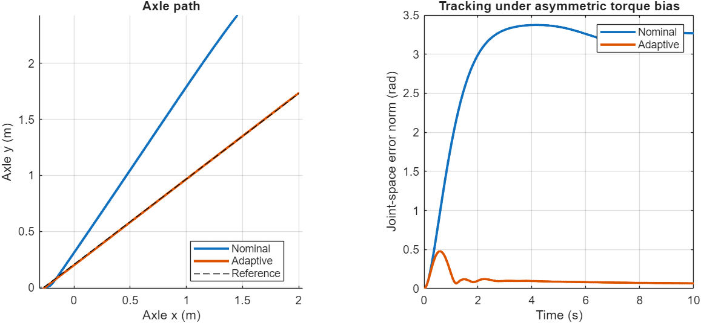
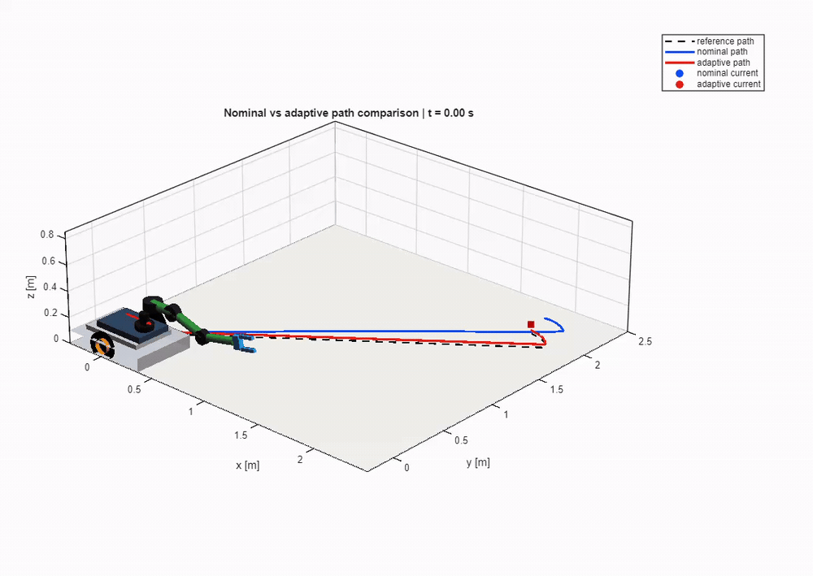

# Adaptive disturbance rejection on a wheeled mobile manipulator

A constant torque bias on the right wheel pushes the robot away from its planned path. Can an online estimate recover tracking, and how much extra torque does that take? This MATLAB experiment compares two controllers on the same five actuated coordinates, with the same plant, reference, feedback gains, and injected disturbance.



## Run the comparison

From the repository root, run the following in MATLAB. The simulation uses core MATLAB functions and was tested with R2025a Update 1.

```matlab
cd('adaptive-control')
results = run_demo();
```

Use `run_demo(true)` to replay both high-disturbance trajectories in 3-D. Each invocation checks the model, runs six ten-second simulations, and writes the results table and comparison figure beside the code.

| Matched torque disturbance | Nominal RMS (rad) | Adaptive RMS (rad) | Reduction |
| --- | ---: | ---: | ---: |
| Moderate constant | 0.754 | 0.041 | 94.53% |
| High asymmetric constant | 3.045 | 0.137 | 95.52% |
| Sinusoidal, five frequencies | 0.956 | 0.213 | 77.77% |

The high case adds [0.9, 0.1, 0.1, 0.1, 0.1] N·m to the right wheel, left wheel, and three arm joints. Adaptation lowers angular tracking error and raises RMS torque from 12.26 to 13.64 N·m. Net actuator work is 96.72 J nominal and 96.47 J adaptive. This signed integral allows braking work to offset positive work. [Full results](results.csv)

## Animation

<p align="center">
  
</p>

The committed GIF is the original animation embedded in slide 11 (*Robot Demo: Animation and Key Snapshots*) of my May 2026 Adaptive Feedback Linearization course presentation. It is preserved byte-for-byte (1000 × 709 pixels, 128 frames). The black dashed curve is the reference, blue is nominal feedback linearization, and red is adaptive feedback linearization. The presentation's original high-disturbance experiment reported a 92.71% RMS tracking-error reduction (2.50076 to 0.182203 rad); the corrected axle-centered benchmark in this repository reports 95.52% (3.045443 to 0.136503 rad). These are separate model versions; the original animation illustrates the earlier experiment and is not quantitative evidence for the corrected results.

To generate an animation directly from the MATLAB ODE45 simulation:

```matlab
run_demo(true, fullfile(pwd,'nominal-vs-adaptive-local.gif'));
```

The local animation uses the corrected benchmark and a different renderer. It requires an interactive MATLAB graphics session. Use a separate output filename to preserve the original presentation GIF.

## From robot geometry to torque

The state uses the axle midpoint and yaw, two wheel angles, and three arm angles. The mount lies 0.27 m ahead of the axle. Equal and opposite wheel speeds turn the robot around the axle midpoint. The mount follows an arc. The reference joins two mount poses through axle rotation, straight translation, and a final rotation. A single quintic per segment supplies wheel position, velocity, and acceleration analytically. Arm motion uses the same quintic timing over ten seconds. [Reference generator](reference.m)

Write $u=\dot\eta$ for the wheel and arm rates and $\dot q=R(q)u$. Forward speed is $r(u_r+u_l)/2$, yaw rate is $r(u_r-u_l)/(2L)$, and axle lateral speed is zero. For each body, $J_i$ maps $u$ to world center-of-mass velocity. Projecting its translational acceleration gives $m_iJ_i^T(J_i\dot u+\dot J_i u)$. The model adds the course model’s constant effective rotational inertias and diagonal viscous damping. Upward height gives $U=\sum_i m_i g z_i$. Wheel and joint torques enter through the identity matrix. [Model](robot_model.m) · [SI parameters](parameters.json)

$$M\dot u+c+Du+G=\tau+d.$$

For $e=\eta-\eta_d$, define $s=\dot e+\Lambda e$. The controller uses

$$\tau=M(\ddot\eta_d-\Lambda\dot e-K_s s)+c+Du+G-\hat d.$$

The nominal baseline holds the estimate at zero. The adaptive update uses the projected velocity $\Gamma M^{-T}s-\sigma\hat d$. Outward updates stop at componentwise estimate bounds. Both controllers use the same diagonal gains with $K_s=\Lambda$. [Controller and case definitions](run_demo.m)

For exact cancellation, constant matched disturbance, zero leakage, inactive projection, and unsaturated torque, let $\tilde d=d-\hat d$. Then $\dot s=-K_s s+M^{-1}\tilde d$. With $V=(s^Ts+\tilde d^T\Gamma^{-1}\tilde d)/2$, substitution gives $\dot V=-s^TK_s s$. For bounded $M^{-1}$ on a forward-complete trajectory, $s$ is bounded and square-integrable with bounded derivative, giving $s\to0$. The stable filter $\dot e=-\Lambda e+s$ gives angular tracking. The numerical cases include leakage. For bounded differentiable $d$, their continuous-time Lyapunov derivative gains the term $-\sigma\|\tilde d\|_{\Gamma^{-1}}^2+\tilde d^T\Gamma^{-1}(\dot d+\sigma d)$. This yields an ultimate bound under exact cancellation and diagonal projection with the true disturbance inside the box.

## What the checks cover

At 32 deterministic configurations the checks verify rolling constraints, positive-definite symmetric inertia, kinetic power balance, and agreement with a separately computed full-coordinate Euler–Lagrange force projected into wheel and arm coordinates. They also check gravity holding torque at the horizontal arm pose, pure rotation about the axle, and derivatives of the reference. [Validation code](verify_model.m)

ODE45 uses relative tolerance 1e-6, absolute tolerance 1e-8, and maximum internal step 0.02 s. The two controllers share a 0.01 s output grid. RMS values use trapezoidal integration over time. The error norm weights each of the five angular coordinates equally.

## Scope and provenance

This corrected benchmark develops Muhammed Elyamani’s SCE 527 adaptive feedback-linearization project on the earlier mobile-manipulator planning and tracking framework credited to Muhammed Elyamani, Ali Attyatullah Mohammed AlBeladi, and Brahim Brahmi. The original reports and historical figures document earlier model versions. This release uses the offline reference, a matched actuator disturbance, exact model knowledge, and unrestricted commanded torque. The 3-D replay visualizes simulation. Hardware validation, online replanning, and physical parameter identification are outside the benchmark. [Earlier framework and attribution](../README.md)
